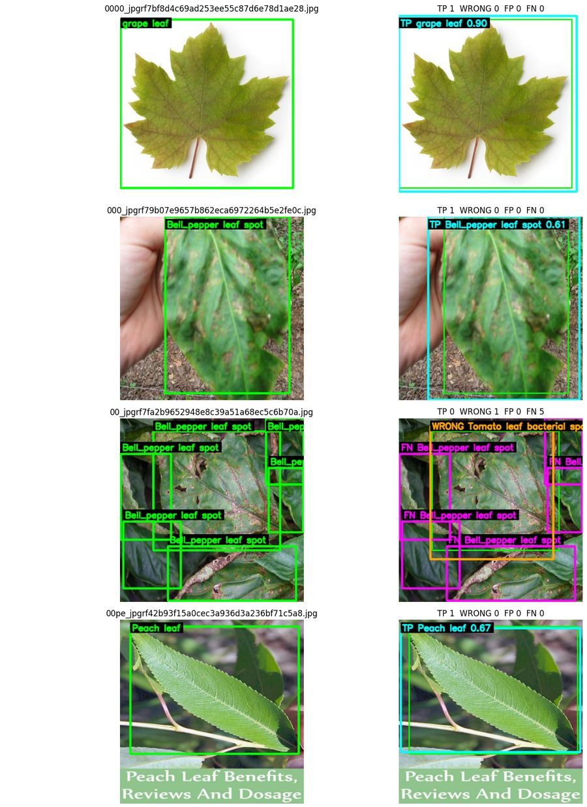
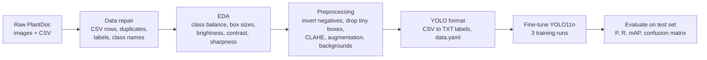
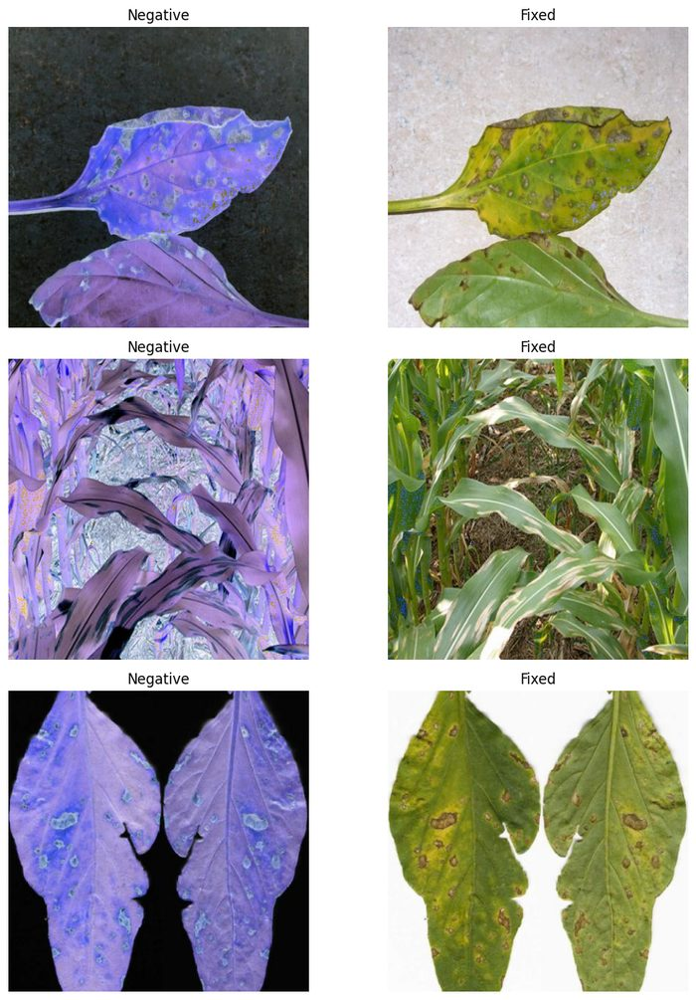
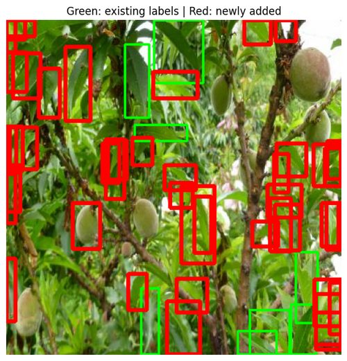
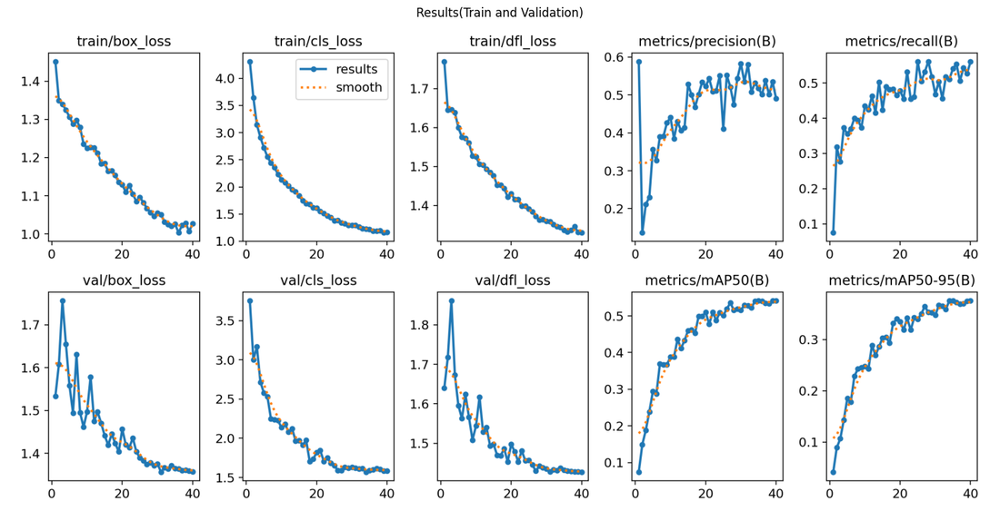
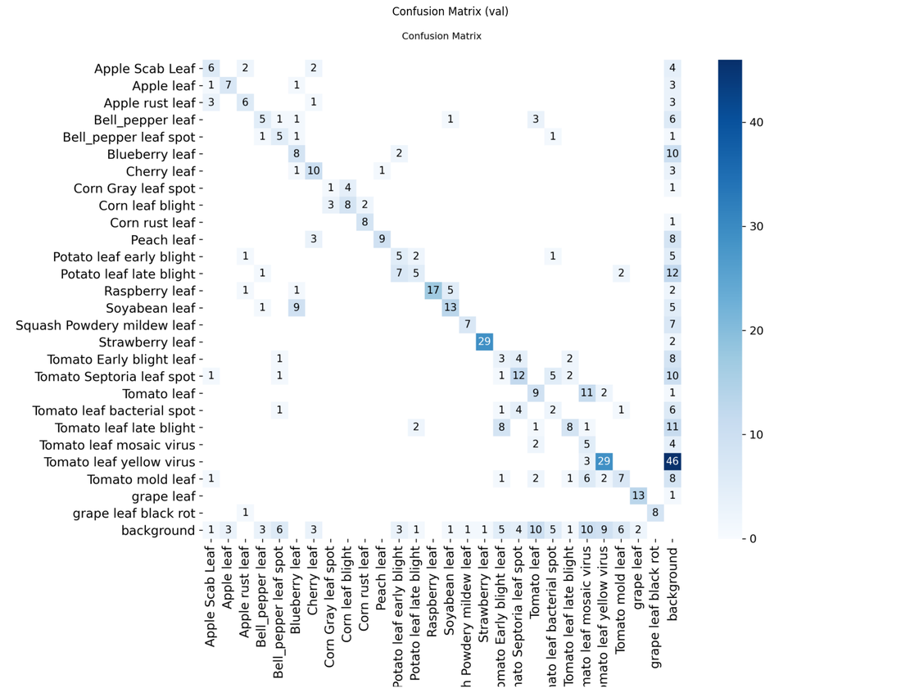

# Plant Disease Detection in the Wild with YOLO11

Detecting and classifying diseased and healthy leaves in real-world photos (cluttered backgrounds, uneven lighting, several leaves per image) using a fine-tuned **YOLO11** object detector and a data-centric cleaning pipeline.



*Left: ground-truth boxes. Right: model predictions on unseen test images (TP = correct, WRONG = wrong class, FN = missed, FP = extra detection).*

## Highlights

- **27-class object detector** for leaves of 13 crop species, trained on the in-the-wild **PlantDoc** dataset.
- **Test mAP@50 = 0.587, mAP@50-95 = 0.481** (238 test images, 454 objects) with a lightweight 2.6M-parameter YOLO11n model.
- **Data-centric pipeline:** fixed corrupted CSV rows, inverted-colour images, mislabelled samples, tiny boxes, and low-contrast images (CLAHE) before training.
- **Label-noise experiments:** used the trained model to mine missing annotations and to mask unlabeled leaf regions, and measured the effect on test performance.

## Problem

Plant diseases cause major crop losses, and expert diagnosis is not always available in the field. Most leaf-disease datasets are photographed in the lab on plain backgrounds, so models trained on them fail on real photos. PlantDoc contains internet images taken in realistic conditions, which makes detection harder but much closer to real deployment, for example in a farmer's phone app.

## Data

- **Dataset:** [PlantDoc](https://github.com/pratikkayal/PlantDoc-Object-Detection-Dataset) (Singh et al., CoDS-COMAD 2020, CC BY 4.0), Roboflow 416×416 export: 2,567 images with bounding boxes across 30 classes.
- **After cleaning:** 27 classes. Two classes with only 2–3 images were removed, one misspelled class name was merged, and one mislabelled image was corrected.
- **Splits:** the original train/test split, plus a 10% validation split carved from training. Background-only images were added to reduce false positives.

## Approach



**Data quality work**
- Repaired malformed CSV rows, checked image–annotation consistency in both directions, and removed duplicates.
- Detected and corrected **colour-inverted images** using channel statistics.

  
- Measured brightness, contrast and sharpness per bounding box, filtered extreme outliers, and applied **CLAHE** only to low-contrast images.
- Offline augmentation with Albumentations, then conversion to YOLO label files.

**Model and training**
- **Model:** YOLO11n (Ultralytics), transfer learning from pretrained weights.
- **Settings:** 640 px input, 40 epochs, batch 32, AdamW (selected automatically by Ultralytics, lr ≈ 3.2e-4), cosine learning-rate schedule, early stopping, trained on 2× Tesla T4 GPUs (Kaggle).
- **Augmentation:** horizontal flips, small rotations, translation, scaling, HSV colour jitter, mosaic. Augmentations that distort leaf shape or blend images (shear, perspective, MixUp, copy-paste) were deliberately disabled.

**Handling incomplete annotations (Runs 2 and 3)**
Many PlantDoc images contain leaves that were never labelled, so the model is penalised for detecting them.
- **Run 2:** the Run 1 model scanned the training set for confident detections with no matching label. Detections that passed confidence, overlap, size and class checks were added as new labels.
- **Run 3:** instead of adding labels, likely unlabeled leaf regions were masked with the image's mean colour ("cutout"), while protecting all ground-truth boxes.



## Results

Test set: 238 images, 454 objects, confidence threshold 0.25, IoU threshold 0.50.

| Run | Training data | Precision | Recall | mAP@50 | mAP@50-95 |
|---|---|---:|---:|---:|---:|
| **Run 1** | Cleaned dataset (baseline) | 0.558 | 0.572 | **0.587** | **0.481** |
| Run 2 | + labels mined by the model | **0.577** | 0.522 | 0.572 | 0.469 |
| Run 3 | + cutout of unlabeled regions | 0.529 | **0.584** | 0.558 | 0.449 |

**Per-class performance varies widely** (Run 1, mAP@50):
- **Easiest:** Strawberry leaf 0.98, Corn rust leaf 0.95, Peach leaf 0.91, Squash powdery mildew 0.91
- **Hardest:** Tomato leaf bacterial spot 0.15, Tomato mold leaf 0.21, Tomato early blight 0.24



<details>
<summary>Confusion matrix (Run 1)</summary>


</details>

## Key takeaways

- **The baseline was the best model.** Adding model-generated labels (Run 2) raised precision but lowered recall and mAP, and masking (Run 3) did the opposite. Automatically "fixing" annotations with the model's own predictions did not beat a clean baseline here.
- **Most errors are confusions between similar diseases on the same crop**, especially the 8 tomato classes, rather than missed leaves. In the Run 3 test evaluation, 142 of the 454 objects were found but given the wrong class, while only 49 were missed entirely.
- **Possible next steps:** a larger YOLO model, a two-stage design (leaf detector + disease classifier on crops), and targeted data collection for the weakest tomato classes.

## Repository structure

```
plant-disease-detection-yolo/
├── notebooks/
│   └── plantdoc_yolo11_detection.ipynb   # full pipeline: cleaning, EDA, preprocessing, training, evaluation
├── figures/                              # figures used in this README
├── docs/
│   └── report_summary.md                 # summary of the project report
└── requirements.txt
```

## How to run

The notebook was developed on **Kaggle** with GPU acceleration and uses `/kaggle/working/` paths.

1. Create a Kaggle notebook with a GPU, and upload `notebooks/plantdoc_yolo11_detection.ipynb`.
2. Download the PlantDoc dataset in YOLO-compatible 416×416 format (for example, the Roboflow export of [PlantDoc](https://github.com/pratikkayal/PlantDoc-Object-Detection-Dataset)) and an optional folder of background-only images. Zip them as `PlantDoc 416x416.zip` and `Background 416x416.zip` inside `/kaggle/working/Plantdoc-image-processing/Dataset/`.
3. Run the cells in order. The pretrained `yolo11n.pt` weights are downloaded automatically.
4. To run locally instead: `pip install -r requirements.txt`, then replace the `/kaggle/working/` paths with a local folder.

If the notebook doesn't render on GitHub, view it on [nbviewer](https://nbviewer.org/github/AmirmohsenSamadi/plant-disease-detection-yolo/blob/main/notebooks/plantdoc_yolo11_detection.ipynb).

## Project context

Project for the *Data Mining and Machine Learning* course, MSc Data Science, University of Naples Federico II (February 2026). A summary of the full project report is in [`docs/report_summary.md`](docs/report_summary.md).
